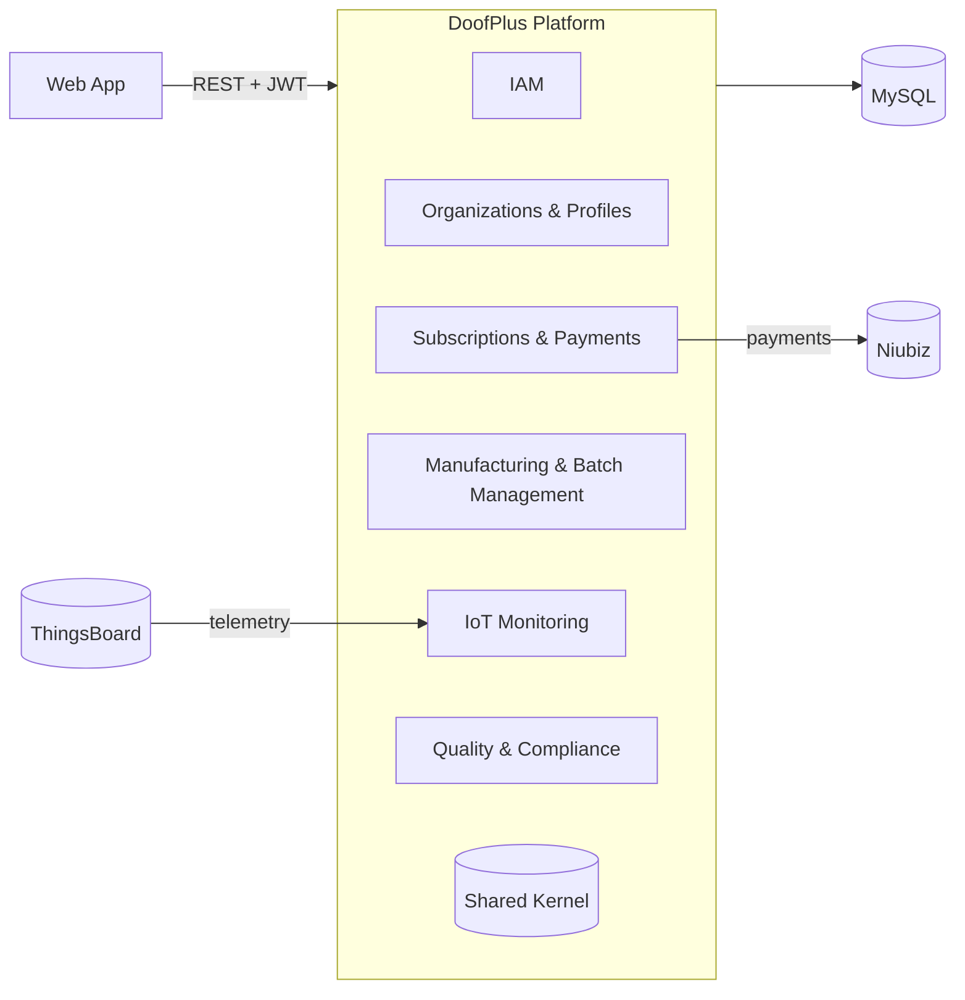

# DoofPlus Platform

> RESTful API of **DoofPlus**, the quality management and batch traceability platform for pharmaceutical laboratories.


DoofPlus Platform is the backend that powers the DoofPlus Web Application. It covers the full lifecycle of a pharmaceutical batch: from the master formula and the production order, through IoT monitoring of equipment and sensors, to deviation management, CAPA plans, audits and the final **batch release** by Quality Assurance. It also handles organizations, users, subscriptions and payments.

---

## Table of Contents

- [Deployment](#deployment)
- [Tech Stack](#tech-stack)
- [Architecture](#architecture)
- [Bounded Contexts](#bounded-contexts)
- [Project Structure](#project-structure)
- [Getting Started](#getting-started)
- [Configuration](#configuration)
- [API Documentation](#api-documentation)
- [Authentication and Authorization](#authentication-and-authorization)
- [Error Handling](#error-handling)
- [Testing](#testing)
- [Docker](#docker)
- [Versioning and Changelog](#versioning-and-changelog)
- [Contributing](#contributing)
- [License](#license)

---

## Deployment

| Resource       | URL / Detail                                                      |
|----------------|-------------------------------------------------------------------|
| **API**        | https://doofplus-platform.onrender.com/api/v1                     |
| **Swagger UI** | https://doofplus-platform.onrender.com/swagger-ui.html            |
| **Hosting**    | Render, Docker image of `main` (Manual Deploy after each release) |
| **Database**   | MySQL on Railway                                                  |

> [!NOTE]
> The free plan of Render puts the service to sleep when it is not used, so the first request can take about a minute.

---

## Tech Stack

| Layer            | Technology                                                            |
|------------------|-----------------------------------------------------------------------|
| Language         | Java 27 (virtual threads enabled)                                     |
| Framework        | Spring Boot 4.1.1 (Web MVC, Data JPA, Validation, Security)           |
| Persistence      | MySQL + Hibernate, `snake_case` naming strategy with pluralized tables |
| Security         | Spring Security + JWT (jjwt 0.13) + two-factor authentication (six-digit code) |
| Documentation    | springdoc-openapi 3.1 (OpenAPI 3 + Swagger UI)                        |
| Utilities        | Lombok, Pluralize, JSpecify (`@NullMarked`)                           |
| Integrations     | **Niubiz** (payment gateway), **ThingsBoard** (IoT telemetry)         |
| Build / Runtime  | Maven Wrapper, multi-stage Docker (Eclipse Temurin 27)                |

---

## Architecture

The project is a **modular monolith** built with **Domain-Driven Design (DDD)** and **CQRS** at the application level. Each bounded context is a self-contained package with four layers:

```
<context>/
├── domain/            # Pure model: aggregates, entities, value objects, commands, queries, events
│   ├── model/
│   ├── repositories/  # Persistence ports (interfaces)
│   └── exceptions/
├── application/       # Use cases
│   ├── commandservices/   # Write contracts
│   ├── queryservices/     # Read contracts
│   └── internal/          # Implementations, event handlers, outbound services
├── infrastructure/    # Adapters: JPA, external gateways, security
│   └── persistence/jpa/{entities,repositories,adapters,assemblers,converters}
└── interfaces/        # Inbound ports
    ├── rest/          # Controllers, resources (DTOs) and transformers
    └── acl/           # Anti-Corruption Layer / facades for other contexts
```

Key design decisions:

- **Domain model decoupled from JPA.** Domain aggregates are not JPA entities; the `infrastructure/persistence/jpa` layer defines its own `*PersistenceEntity` classes and uses *assemblers* to translate between both worlds. Domain repositories are interfaces implemented by *adapters*.
- **Lightweight CQRS.** Writes go through `*CommandService.handle(Command)` and reads through `*QueryService.handle(Query)`.
- **Errors as values.** Use cases return `Result<T, ApplicationError>` (a sealed `Success` / `Failure` interface) instead of throwing business exceptions; `ResponseEntityAssembler` maps it to the proper HTTP response.
- **Communication between contexts** through ACL facades (e.g. `IamContextFacade`) and domain events published with `DomainEventPublisher`.
- **Shared kernel** (`shared/`) with `AbstractDomainAggregateRoot`, a base auditable entity, i18n, CORS, OpenAPI, global error handling and concurrency configuration (Loom).



---

## Bounded Contexts

| Context | Package | Responsibility | Main resources (`/api/v1/...`) |
|---|---|---|---|
| **IAM** | `iam` | Sign-up, sign-in with JWT and 2FA, users, roles and invitations | `authentication`, `users`, `roles`, `tokens`, `invitations` |
| **Organizations & Profiles** | `organizations` | Organizations (RUC validation), facilities, user profiles, administrative activities and contact inquiries | `organizations`, `facilities`, `user-profiles`, `administrative-activities`, `contact-inquiries` |
| **Subscriptions & Payments** | `subscriptions` | Plans, subscriptions (activation, renewal, plan/billing cycle change, cancellation) and payments through Niubiz | `plans`, `subscriptions` |
| **Manufacturing & Batch Management** | `manufacturing` | Product catalog, master formulas, production orders, raw material lots and production batches with their statuses, incidents and consumptions | `products`, `master-formulas`, `production-orders`, `material-lots`, `production-batches` |
| **IoT Monitoring** | `monitoring` | Equipment, sensors, readings, alerts and telemetry ingestion from ThingsBoard | `equipment`, `sensors`, `readings`, `alerts`, `telemetry` |
| **Quality & Compliance** | `quality` | Quality documents, deviations and trends, evidence, CAPA plans and actions, analytical results, batch releases, audits and findings, audit events, regulatory reports, collaboration tasks and traceability gaps | `quality-documents`, `deviations`, `deviation-trends`, `evidence`, `capa-plans`, `capa-actions`, `analytical-results`, `batch-releases`, `audits`, `audit-findings`, `audit-events`, `regulatory-reports`, `collaboration-tasks`, `task-comments`, `traceability-gaps` |

> The Quality & Compliance contract follows `contratos/quality-api.json`, derived from the class and database diagrams.

---

## Project Structure

```
doofplus-platform/
├── src/
│   ├── main/
│   │   ├── java/com/ingescompany/doofplus/platform/
│   │   │   ├── IngesCompanyBackendApplication.java
│   │   │   ├── shared/           # Shared kernel
│   │   │   ├── iam/
│   │   │   ├── organizations/
│   │   │   ├── subscriptions/
│   │   │   ├── manufacturing/
│   │   │   ├── monitoring/
│   │   │   └── quality/
│   │   └── resources/
│   │       ├── application.properties        # Common configuration
│   │       ├── application-dev.properties    # Development profile
│   │       ├── application-prod.properties   # Production profile
│   │       ├── messages*.properties          # i18n messages (en / es)
│   │       └── ValidationMessages*.properties
│   └── test/java/...                         # Tests per context
├── .env.example
├── Dockerfile
├── pom.xml
├── CHANGELOG.md
└── CONTRIBUTING.md
```

---

## Getting Started

### Prerequisites

- **JDK 27**
- **MySQL 8+** running locally (or through Docker)
- Git
- (Optional) Docker

> You do not need to install Maven: the project ships with the Maven Wrapper (`./mvnw`).

### Installation

```bash
# 1. Clone the repository
git clone https://github.com/IngesCompany/doofplus-platform.git
cd doofplus-platform

# 2. Create the environment file from the template
cp .env.example .env
#    ...and set your MySQL credentials and JWT_SECRET

# 3. (Optional) Start MySQL with Docker
docker run -d --name doofplus-mysql \
  -e MYSQL_ROOT_PASSWORD=password \
  -p 3306:3306 mysql:8

# 4. Run the application (dev profile by default)
./mvnw spring-boot:run
```

In the `dev` profile the `doofplus-os` database is created automatically (`createDatabaseIfNotExist=true`) and the schema is synchronized with `ddl-auto=update`. On startup, the application seeds the IAM base data (roles).

The API is available at `http://localhost:8080/api/v1` and Swagger UI at `http://localhost:8080/swagger-ui.html`.

> [!TIP]
> Spring Boot does not load `.env` files natively. Export the variables in your shell (`set -a; source .env; set +a`) or configure them in your IDE.

---

## Configuration

### Profiles

| Profile | Usage | Characteristics |
|---|---|---|
| `dev` (default) | Local development | Default values for a local MySQL, `show-sql=true`, creates the database if it does not exist |
| `prod` | Production (Docker) | No default credentials, SSL connection, `open-in-view=false`, does not create the database |

### Environment Variables

| Variable | Description | Default (dev) | Required in prod |
|---|---|---|---|
| `SPRING_PROFILES_ACTIVE` | Active profile | `dev` | ✅ (`prod` in the Docker image) |
| `PORT` | HTTP port | `8080` | — |
| `DATABASE_URL` | MySQL host | `localhost` | ✅ |
| `DATABASE_PORT` | MySQL port | `3306` | — |
| `DATABASE_NAME` | Database name | `doofplus-os` | ✅ |
| `DATABASE_USER` | MySQL user | `root` | ✅ |
| `DATABASE_PASSWORD` | MySQL password | `password` | ✅ |
| `JWT_SECRET` | JWT signing secret (**at least 32 characters**) | Development value | ✅ (the `prod` profile does not start without it) |
| `CORS_ALLOWED_ORIGINS` | Comma-separated origins allowed to call the API | Web App on Firebase, Website on GitHub Pages and `http://localhost:4200` | — |
| `NIUBIZ_BASE_URL` | Niubiz base URL | Niubiz sandbox | ✅ |
| `NIUBIZ_MERCHANT_ID` | Niubiz merchant ID | — | ✅ |
| `NIUBIZ_USERNAME` | Niubiz API user | — | ✅ |
| `NIUBIZ_PASSWORD` | Niubiz API password | — | ✅ |
| `THINGSBOARD_API_KEY` | API key used to validate incoming telemetry | — | ✅ |

> [!WARNING]
> The default `JWT_SECRET` is for development only. Never use it in production and never commit your `.env` file (it is already in `.gitignore`).

---

## API Documentation

The OpenAPI documentation is generated automatically by springdoc:

- **Swagger UI:** `/swagger-ui.html`
- **OpenAPI specification (JSON):** `/v3/api-docs`

API conventions:

- Every route is versioned under `/api/v1` and uses plural nouns in *kebab-case* (`/capa-plans`, `/batch-releases`).
- `GET /{resource}` lists (with optional query-param filters, e.g. `?batchCode=`, `?organizationId=`), `GET /{resource}/{id}` reads one, `POST` creates, `PUT /{id}` updates and `DELETE /{id}` deletes.
- Enums are **returned in `UPPER_SNAKE_CASE`** and **accepted in `kebab-case`**.
- The API answers in English or Spanish according to the `Accept-Language` header (English by default).

---

## Authentication and Authorization

1. **Sign-up:** `POST /api/v1/authentication/sign-up`
2. **Sign-in:** `POST /api/v1/authentication/sign-in` → two-step verification with a six-digit code.
3. Send the returned token in every request:

```http
Authorization: Bearer <jwt>
```

Tokens expire after **7 days**. Some operations are restricted to the `ADMINISTRATOR` role (listing users, managing invitations, reading contact inquiries).

---

## Error Handling

Errors follow **RFC 9457 (Problem Details for HTTP APIs)** with localized messages (en/es). HTTP status codes have a consistent meaning across the platform:

| HTTP | Error code | When |
|---|---|---|
| `400` | `VALIDATION_ERROR` | Invalid input data |
| `401` | — | Missing authentication or invalid token |
| `403` | — | The user does not have the required role |
| `404` | `<RESOURCE>_NOT_FOUND` | The resource does not exist |
| `409` | `<RESOURCE>_CONFLICT` / `<RESOURCE>_STATE_CONFLICT` | Duplicates or a state transition that is not allowed |
| `422` | `BUSINESS_RULE_VIOLATION` | Business rejection (formula not approved, payment rejected…) |
| `503` | — | External service unavailable (e.g. Niubiz) |

---

## Testing

```bash
# Run the whole suite
./mvnw test

# Run a single test class
./mvnw test -Dtest=SubscriptionTest
```

The suite combines domain unit tests (aggregates and value objects), application service tests with test doubles, contract tests (`QualityContractTest`) and tests of the shared infrastructure (error handling, i18n, events, Niubiz gateway).

---

## Docker

The image is built in two stages (Maven build, JRE 27 runtime) and starts with the `prod` profile:

```bash
docker build -t doofplus-platform .

docker run -p 8080:8080 \
  -e DATABASE_URL=<host> \
  -e DATABASE_NAME=<db> \
  -e DATABASE_USER=<user> \
  -e DATABASE_PASSWORD=<password> \
  -e JWT_SECRET=<secret-of-at-least-32-characters> \
  doofplus-platform
```

---

## Versioning and Changelog

- The project follows **[Semantic Versioning](https://semver.org/spec/v2.0.0.html)**.
- Changes are recorded in [`CHANGELOG.md`](CHANGELOG.md) using the **[Keep a Changelog](https://keepachangelog.com/en/1.0.0/)** format.
- Branching model: **GitFlow** (`main`, `develop`, `feature/*`, `release/*`, `hotfix/*`).

---

## Contributing

Want to contribute? Read the [contributing guide](CONTRIBUTING.md) to learn about the branching model, commit conventions and the structure new code must follow.

---

## License

See the [`LICENSE.md`](LICENSE.md) file.

---

<p align="center">Built by <strong>IngesCompany</strong></p>